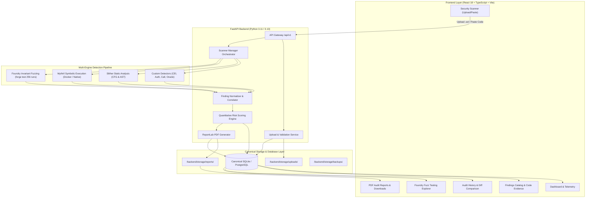

# System Architecture Documentation: SecureChain Auditor

## 1. System Overview

**SecureChain Auditor** is an enterprise-grade automated security auditing platform for Solidity smart contracts on the Ethereum and EVM-compatible blockchains. It integrates multi-engine static analysis, symbolic execution, dynamic invariant property fuzzing, and custom semantic detectors into a unified pipeline with finding correlation, calibrated risk scoring, and automated PDF audit report generation.

---

## 2. Architecture Diagram

---

## 3. End-to-End Execution Flow

1. **Contract Ingestion**:
   - The user uploads a `.sol` file or pastes source code via the React UI.
   - The backend validates the Solidity pragma version, checks for minimum contract syntax, sanitizes path traversal attempts, and stores the file into the canonical uploads directory (`backend/storage/uploads/`).
   - The contract metadata (name, compiler version, sha256 hash) is persisted in the database.

2. **Scanner Orchestration (`ScannerManager`)**:
   - The backend spawns selected analyzers concurrently using Python's `asyncio`.
   - **Custom Detection Engine**: Executes high-precision AST and semantic checks for Reentrancy (CEI violations), Access Control (missing modifiers, `tx.origin`), Unchecked Calls (unhandled return values), and Oracle Manipulation (spot reserve pricing).
   - **Slither Static Analysis**: Runs via subprocess with `--compile-force-framework solc --json -` to inspect control flow graphs and compiler diagnostics.
   - **Mythril Symbolic Execution**: Checks for Docker daemon or native `myth` CLI availability. If unavailable, flags Mythril as unverified and preserves honest execution reporting.
   - **Foundry Invariant Fuzzing**: Executes `forge test --fuzz-runs 256` against parameterized invariant harnesses, validating solvency, authorization, and reentrancy resilience under 256 randomized state transactions.

3. **Finding Normalization & Deduplication (`FindingCorrelator`)**:
   - Raw findings from all engines are converted into standardized `FindingSchema` objects with unified categories, line ranges, and CVSS v3.1 base metrics.
   - Findings that target the same AST function and overlap within a ±3 line window are clustered.
   - Corroborated findings are assigned elevated confidence ratings.

4. **Calibrated Risk Assessment (`RiskEngine`)**:
   - Computes weighted vulnerability scores:
     - `CRITICAL`: 35.0 base points
     - `HIGH`: 20.0 base points
     - `MEDIUM`: 8.0 base points
     - `LOW`: 3.0 base points
     - `Foundry Invariant Failure`: 15.0 base points
   - Category thresholds ensure single catastrophic flaws escalate appropriately (e.g., Critical $\ge$ 80.0, High $\ge$ 55.0).
   - Pure informational compiler advisories (floating pragma, verified low-level calls) carry zero weight, allowing secure contracts to achieve a true 0.0 `SECURE` risk score.

5. **Reporting & PDF Generation (`PDFGenerator`)**:
   - Compiles a publication-ready audit certificate using ReportLab.
   - Includes executive summary, risk gauge, findings breakdown, line-numbered source evidence, and contextual remediation recommendations.
   - Stores the generated report in `backend/storage/reports/` with direct download capability.

---

## 4. Subsystem Breakdown

### Frontend (React 18 + TypeScript + Vite)
- **Dashboard**: System-wide telemetry, audit volume, severity distribution charts, and recent audits.
- **Scanner**: Dual-mode ingestion (file upload or direct editor paste), engine checkboxes, and real-time scanning progress tracking.
- **Findings Catalog**: Searchable and filterable vulnerability explorer with line-level code snippets and remediation guides.
- **Audit History**: Historical audit list with version-to-version diffing (`/api/v1/history/compare`).
- **Foundry Fuzz Testing**: Interactive view of invariant tests, pass/fail status, and concrete counterexample calldata traces.
- **PDF Reports**: Repository of generated audit reports with one-click download.

### Backend (FastAPI + Async SQLAlchemy)
- Fully asynchronous API routes built on FastAPI with Pydantic V2 schemas.
- Canonical storage management guaranteeing working-directory-independent paths.
- Asynchronous database connection pool supporting SQLite (`aiosqlite`) and PostgreSQL (`asyncpg`).
- Secure subprocess runner with timeout enforcement and process tree cleanup.
